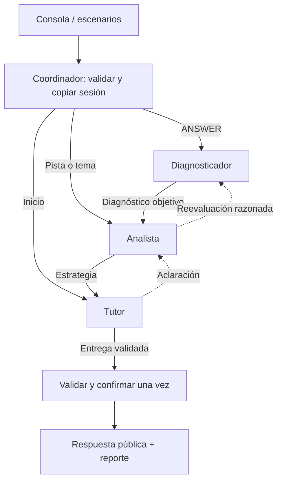

# ThinkAgora · PoC LangChain/LangGraph

Tutor socrático de consola en español. Tres agentes Claude (`diagnostic_agent`, `analyst_agent`, `tutor_agent`) con herramientas propias se transfieren el control mediante `Command.PARENT`. No hay supervisor LLM. El coordinador valida reglas y confirma el estado en memoria una sola vez por turno.

Implementación guiada por [la guía técnica](thinkagora-poc-langchain-guia-implementacion.md) y [el contrato pedagógico v0.3](thinkagora-poc-contrato-pedagogico-y-pruebas.md). El [registro por hitos](docs/implementation.md) documenta verificación y pendientes.

## Comenzar

Requisito: Node.js 22 o posterior (verificado con Node 24). Las dependencias ya están instaladas en este workspace; en un clon nuevo usa `npm ci`.

1. Abre `.env` y completa **solo** `ANTHROPIC_API_KEY`. Si falta el archivo, copia `.env.example` a `.env`.
2. Ejecuta una interacción controlada con Claude:

   ```powershell
   npm.cmd run scenarios -- E1
   ```

3. Prueba los cinco escenarios y el inicio sin tema:

   ```powershell
   npm.cmd run scenarios
   ```

4. Conversa con el tutor:

   ```powershell
   npm.cmd run dev
   ```

En PowerShell se usa `npm.cmd` para evitar el bloqueo de `npm.ps1` por la política de scripts. En otras terminales puedes usar `npm`.

La consola ofrece tres temas. Selecciona 1–3; después responde A/B/C, usa **4** para pedir pista, **5** para elegir otro tema o `salir` para terminar. No interpreta texto libre como respuesta. El progreso se pierde al cerrar; los reportes permanecen en `outputs/runs/`.

Cada ejecución real consume API de Anthropic. La clave se comparte entre agentes, pero cada solicitud cuenta. Un ANSWER habitual necesita cuatro solicitudes (comprobación y entrega del Diagnosticador, Analista y Tutor); puede haber rutas distintas o un reintento dentro del presupuesto. No se hicieron llamadas reales durante la implementación.

## Verificar sin clave y sin red

```powershell
npm.cmd run typecheck
npm.cmd test
npm.cmd run scenarios -- --mock
```

El modo `--mock` usa respuestas programadas y conserva los agentes `createAgent`, herramientas y grafo reales. Los reportes indican `mode: "mock"`, `llmCalls: 0` y `simulatedModelCalls`; **no** son evidencia de calidad o autonomía de Claude. El transporte HTTP de Anthropic también tiene una prueba simulada que verifica serialización y tokens sin acceder a Internet.

Los ejemplos de [outputs/examples](outputs/examples) son ejecuciones simuladas reproducibles; no constituyen resultados de la API.

## Configuración

| Variable | Valor inicial | Uso |
|---|---|---|
| `ANTHROPIC_API_KEY` | vacía | Credencial privada; requerida solo para ejecución real |
| `ANTHROPIC_MODEL` | `claude-sonnet-4-6` | Mismo modelo para los tres agentes; ajustable según acceso |
| `MAX_OUTPUT_TOKENS` | `2048` | Límite por solicitud |
| `MODEL_TIMEOUT_MS` | `45000` | Tiempo máximo del transporte por solicitud |
| `TURN_TIMEOUT_MS` | `180000` | Tiempo máximo del turno completo |

Se omiten `temperature`, `top_p` y `top_k`; el reporte registra `sampling: "provider-default"`. Reintentos del SDK y de ChatAnthropic: cero. Hay un único reintento explícito para errores transitorios (429, 5xx, conexión/timeout del proveedor) o entrega de herramienta estructuralmente inválida. Un rechazo de política pedagógica aborta, sin reintento oculto. No se requiere LangSmith ni se configura tracing remoto.

No subas `.env` ni pegues la clave en los reportes. `publicConfig` exporta una lista blanca de parámetros y los errores públicos usan códigos, no cuerpos crudos del proveedor.

## Flujo y reglas



- La clave privada determina la corrección. Un diagnóstico que la contradiga se rechaza.
- Primer acierto: `PENDING_VERIFICATION` y pregunta `TRANSFER`; transferencia correcta con evidencia previa: `VERIFIED`. Una transferencia fallida lleva a `IN_PROGRESS`.
- Primer error: pista y misma pregunta. Segundo error consecutivo del concepto: explicación y pregunta `SIMPLIFIED` de dificultad `LOW`. En el piso LOW la simplificación real del contenido se revisa manualmente.
- Pedir pista no suma errores; cambiar tema reinicia el estado activo y conserva historial. La pregunta nueva de E5 puede asignar un concepto pertinente del tema solicitado en el mismo turno, como permite el contrato.
- Entrada inválida: cero llamadas y cero cambios. Fallo, timeout, presupuesto agotado o salida rechazada: sin confirmación. El store usa copias y versiones para impedir escrituras concurrentes sobre snapshots obsoletos.
- Máximos compartidos por turno: **4 activaciones, 3 transferencias, 6 llamadas, 1 reintento**. `recursionLimit=32` es una protección adicional.
- Las claves y justificaciones se excluyen por lista blanca. Se detectan fugas explícitas, pistas que copian la respuesta y declaraciones simples de dominio prematuro. Esto no prueba ausencia de revelaciones por paráfrasis: la revisión pedagógica manual sigue siendo necesaria.

El límite de cuatro activaciones impide completar `Diagnosticador → Analista → Diagnosticador → Analista → Tutor` en un ANSWER. Se aborta conservando la sesión. La ruta alternativa que comienza en Analista se prueba aisladamente; la aclaración `Analista → Tutor → Analista → Tutor` se prueba en un REQUEST_HINT público. La existencia de estas rutas no demuestra que Claude las use de forma útil.

## Organización

| Carpeta | Responsabilidad |
|---|---|
| `src/config` | Entorno, modelo y límites |
| `src/domain` | Contratos Zod, reglas y filtros públicos |
| `src/academic` | Corpus fijo y catálogo de temas/conceptos |
| `src/agents` | Tres agentes, prompts y middleware de límites |
| `src/graph` | Estado temporal, herramientas de handoff y StateGraph |
| `src/services` | Coordinador y confirmación del turno |
| `src/infrastructure` | Store en memoria, callbacks, reportes y rúbrica |
| `src/fixtures` | Q01–Q03, S0, E1–E5 y modelo simulado |
| `src/cli` | Demo y runner |
| `src/tests` | Pruebas sin API |

Los agentes solo producen propuestas temporales. Cada uno recibe un contexto acotado; no se copia todo el historial entre agentes. El par AIMessage/ToolMessage de cada handoff tiene IDs compatibles y queda en el estado temporal. Solo `TurnCoordinator` confirma el progreso canónico durante los turnos; `reset` se usa para precargar fixtures.

## Reportes y evaluación

RP09 se aplica como objetivo de concisión, no como condición para confirmar el turno. Si el mensaje, la pregunta y las opciones superan 100 palabras, el reporte agrega `observations` con `CONCISION_TARGET_EXCEEDED`, `targetWords` y `actualWords`. Una intervención extensa sigue su curso si cumple las demás validaciones. `error.validationDetail` conserva el motivo de los rechazos del código sin publicar cuerpos del proveedor.

Para comparar con Vercel AI SDK, usa el mismo `scrum.md`, Q01–Q03, snapshots E1–E5, modelo y parámetros efectivos. Aplica también esta interpretación de RP09 en ambos enfoques. Ejecuta cada escenario desde su snapshot limpio y compara la rúbrica manual, llamadas, tokens y latencia; no compares los reportes simulados con resultados reales. Las corridas anteriores a esta corrección conservan su valor como incidentes, pero deben repetirse para comparar la versión corregida.

Cada runner crea `outputs/runs/live-scenarios-<id>` o `mock-scenarios-<id>`, con:

- `E1.json`–`E5.json`: respuesta pública, estado antes/después sin claves, estrategia, llamadas, uso, latencia y errores.
- `START.json`: chequeo independiente de inicio sin tema.
- `handoffs.json`: transferencias aceptadas/rechazadas con razón y correlación.
- `summary.json`: rutas e incidentes, sin dictamen sobre efectividad educativa.
- `rubric.json`: tres verificaciones por caso con `passed: null`, evidencia vacía y fallos críticos pendientes.

La demo guarda un JSON por turno, incluidas entradas inválidas y errores. El formato conserva los campos del contrato para una futura comparación con AI SDK; no se tuvo acceso a una implementación externa de ese formato.

`llmCalls` cuenta invocaciones del chat model mediante callbacks, incluidas las fallidas y reintentos. Los tokens provienen de `usage_metadata` una sola vez por ID de llamada. Si no hay uso reportado quedan `null` por llamada; los totales suman solo datos conocidos y `usageIncomplete` señala la ausencia. La latencia es tiempo de pared hasta tener lista la respuesta y el estado, excluyendo escritura a disco y precarga del fixture. Timestamps ISO en UTC; no son horarios de Guayaquil.

Completa manualmente `rubric.json` tras leer cada respuesta. Anota fugas, dominio prematuro, contenido sin respaldo o pérdida de historial por separado. Calcula `(cumplidas / aplicables) × 100` únicamente después de revisar. Un turno con error no cuenta como aprobado. No se incluye un LLM evaluador.

## Material y pendientes

El material activo se lee de `scrum.md` en la raíz al iniciar el proceso. Puedes editarlo y reiniciar la consola para aplicar cambios. Conserva las secciones numeradas `## 1.` a `## 5.`: introducción, responsabilidades, eventos, artefactos y caso práctico. El cargador valida que existan y tengan contenido; no valida automáticamente su calidad académica. Los tres temas conservan sus IDs para mantener Q01–Q03 y E1–E5. Los reportes incluyen `sourceHash` del archivo y `sha256` del corpus procesado. El contenido se entrega como datos al Tutor, sin RAG.

La implementación y las verificaciones sin red están completas. **Pendiente de aceptación H3:** añadir la clave, ejecutar E1 real y revisar el recorrido de los tres agentes; después ejecutar E1–E5 y completar la rúbrica. Queda pendiente cualquier comparación con AI SDK. AI SDK no se necesita para ejecutar esta PoC. RP10 queda fuera de alcance, igual que frontend, RAG, persistencia, despliegue y autenticación.

APIs contrastadas con documentación y código instalado: [createAgent](https://docs.langchain.com/oss/javascript/langchain/agents), [handoffs de subgrafos](https://docs.langchain.com/oss/javascript/langchain/multi-agent/handoffs), [ChatAnthropic](https://docs.langchain.com/oss/javascript/integrations/chat/anthropic). Versiones exactas en `package-lock.json`.
