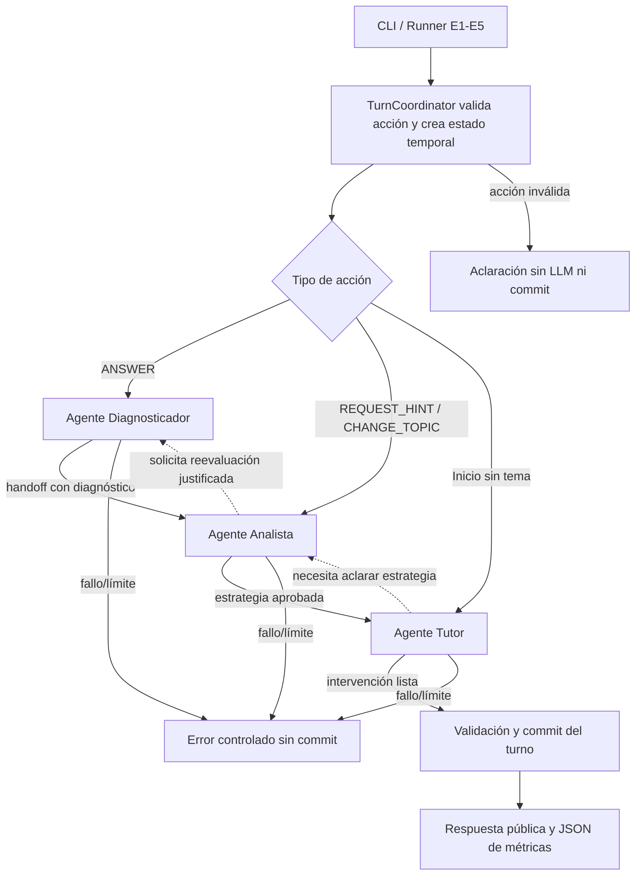

# ThinkAgora — Guía de implementación de la PoC multiagente con LangChain/LangGraph

**Versión:** 1.0 · **Fecha:** 20/10/2026 · **Destino:** agente de programación · **Estado:** especificación de una PoC, no arquitectura productiva.

> **Instrucción al agente implementador:** desarrolla **solo** esta PoC en **Node.js + TypeScript**, implementando **tres agentes LLM distintos**: Diagnosticador, Analista pedagógico y Tutor. Ejecuta los hitos H1–H5 **uno por uno**. Al terminar cada hito, muestra archivos creados/modificados, comandos y pruebas ejecutadas, resultados y bloqueos; **detente y solicita revisión antes de comenzar el siguiente**. No agregues un agente supervisor ni conviertas los tres agentes en simples funciones llamadas siempre en orden fijo. No cambies el contrato pedagógico para acomodar la librería.

## 0. Fuente de verdad, objetivo y alcance

**Documento obligatorio:** `thinkagora-poc-contrato-pedagogico-y-pruebas.md` **v0.3**. Aplicar sus reglas **RP01–RP10**, tipos, preguntas **Q01–Q03**, estado **S0**, escenarios **E1–E5**, rúbrica y protocolo de medición. Si el archivo falta, **solicitarlo**: no recrear escenarios de memoria ni alterar sus claves. La presente guía explica **cómo** construir la alternativa multiagente; no sustituye el contrato.

**Pregunta a contestar:** ¿la coordinación autónoma de tres agentes mejora de forma observable la intervención pedagógica lo suficiente para justificar sus llamadas, tokens, latencia y complejidad frente a tres responsabilidades deterministas con AI SDK?

**Entorno:** consola, estado de sesión en memoria, mismo material académico de Scrum precargado, **una sola API Key de Anthropic** compartida por los tres agentes, sin frontend. Cada llamada real a Claude consume recursos; contabilizar **todas**.

**Excluir:** NestJS, endpoints REST, RAG, embeddings, SQLite/Supabase, autenticación, despliegue, dashboard, LangSmith como dependencia obligatoria, *AI-as-a-Judge*, agentes adicionales y persistencia definitiva.

**Comparación justa:** mismo corpus, fixtures, modelo y parámetros que la PoC AI SDK. No imponer artificialmente igual cantidad de llamadas. Documentar las diferencias reales de coordinación y contexto.

## 1. Decisiones de diseño innegociables para la PoC

1. **Tres agentes reales** creados mediante `createAgent`, con **system prompt y herramientas propias**: `diagnostic_agent`, `analyst_agent`, `tutor_agent`. No basta con tres prompts ejecutados secuencialmente.
2. **LangGraph coordina sus transferencias** (*handoffs*) mediante `StateGraph` y herramientas que emiten `Command` con destino al grafo padre (`Command.PARENT`) o mecanismo equivalente verificado en la versión instalada. **Sin cuarto agente LLM supervisor**.
3. **Autonomía acotada:** el agente Analista decide cuándo delegar al Tutor o solicitar una reevaluación al Diagnosticador; el Tutor puede solicitar aclaración al Analista si detecta insuficiencia de estrategia/contexto. Los agentes no pueden ignorar RP01–RP09.
4. **La corrección de A/B/C es objetiva:** ofrecer al Diagnosticador una herramienta determinista `checkAnswer`; la IA puede analizar *evidencias*, pero **nunca contradecir la clave** ni declarar que detectó una adivinación. La función de validación del código prevalece.
5. **Estado canónico protegido:** solamente el coordinador de turno confirma modificaciones a la sesión persistida en memoria. Los agentes intercambian **propuestas**, diagnósticos e intervenciones en el **estado temporal del grafo**. Ni los prompts ni las herramientas de *handoff* modifican directamente el `SessionStore`.
6. **Salida pública filtrada:** las claves y justificaciones internas no salen al estudiante. Verificar estructura con Zod antes de confirmar un turno.
7. **Presupuesto de autonomía:** máximo **4 activaciones de agentes por turno**, máximo **3 transferencias entre agentes**, máximo **6 llamadas al modelo por turno** y como máximo **1 reintento técnico explícito** ante un error transitorio o salida inválida, respetando siempre el límite total. Límite de ejecución de LangGraph (`recursionLimit`) como salvaguarda adicional, no sustituto del presupuesto de llamadas. Ante agotamiento, terminar de manera controlada **sin confirmar cambios de sesión**.
8. **Métricas técnicas automáticas**, evaluación pedagógica mediante rúbrica **manual**. Compartir el formato de JSON utilizado por la PoC AI SDK.

> **Nota de diseño:** el uso de tres agentes no garantiza que todos deban participar en cada turno. Los *handoffs* deben reflejar decisiones del modelo y quedar visibles en la traza. Si todas las ejecuciones siguen siempre `Diagnosticador → Analista → Tutor`, explicitar que **no se observó valor de autonomía**, aunque existan tres agentes técnicamente.

### Grafo lógico de un turno



Las flechas discontinuas son **posibilidades, no pasos obligatorios**. Evitar crear una secuencia de llamadas fijas que finja ser agenticidad. El turno acaba al obtener **una intervención validada para el estudiante**, no cuando los agentes quieran iniciar otra conversación entre ellos.

## 2. Stack y configuración

- **Runtime:** Node.js LTS compatible; TypeScript ESM con `strict: true`.
- **Dependencias:** `langchain`, `@langchain/langgraph`, `@langchain/anthropic`, `@langchain/core`, `zod`, `dotenv`.
- **Desarrollo:** `typescript`, `tsx`, `@types/node`; pruebas sin red con `node:test` (o reutilizar la misma herramienta de la otra PoC).
- **LLM:** `ChatAnthropic` desde `@langchain/anthropic`, usado por los **tres agentes**. `createAgent()` desde `langchain`.
- **Variables:** `ANTHROPIC_API_KEY`, `ANTHROPIC_MODEL`, `MAX_OUTPUT_TOKENS` y parámetro de muestreo **solo si es compatible** con el modelo elegido. `.env` privado e ignorado por Git; `.env.example` sin credenciales.
- **Configuración comparable:** misma identificación de modelo, límite de salida y parámetros efectivos que en AI SDK. Algunos modelos de Claude rechazan valores no predeterminados de `temperature`; si ocurre, **omitir el parámetro en las dos PoC**, no forzar un valor distinto.
- **Reintentos:** instanciar `ChatAnthropic` con `maxRetries: 0`; no activar reintentos ocultos de nodos ni del SDK. Implementar a lo sumo uno explícito que se contabilice en métricas. Registrar el modelo y configuración usados en cada corrida.
- **Scripts mínimos:** `npm run dev` (sesión de consola), `npm run scenarios` (E1–E5), `npm test` (sin API), `npm run typecheck`.

Documentación para comprobar APIs según la **versión realmente instalada** (no asumir ejemplos antiguos):

- Agentes JS, `createAgent`: https://docs.langchain.com/oss/javascript/langchain/agents
- Multiagente y *handoffs* (apartado **Multiple agent subgraphs**): https://docs.langchain.com/oss/javascript/langchain/multi-agent/handoffs
- Diseño del estado/grafo: https://docs.langchain.com/oss/javascript/langgraph/thinking-in-langgraph
- Anthropic en LangChain JS: https://docs.langchain.com/oss/javascript/integrations/chat/anthropic

**Evitar:** instalar `deepagents`, `@langchain/langgraph-swarm`, n8n, LangSmith u orquestadores adicionales para resolver esta PoC. No son necesarios para probar el patrón elegido.

## 3. Organización mínima de archivos

```text
src/
  config/              # env, ChatAnthropic y límites de ejecución
  domain/              # contratos compartidos, RP, Zod y estados
  academic/            # mismo corpus fijo de Scrum de la otra PoC
  agents/
    diagnostic.ts       # createAgent, prompt y herramientas propias
    analyst.ts          # createAgent, política y decisiones de handoff
    tutor.ts            # createAgent, generación y entrega estructurada
    prompts.ts          # política común + especialización por agente
  graph/
    handoffs.ts         # herramientas y Command.PARENT; validar destinatarios
    study-graph.ts      # StateGraph, rutas, entradas/salidas, límites
  services/
    turn-coordinator.ts # validación, ejecución de grafo, commit y filtrado
  infrastructure/
    memory-store.ts     # Map<sessionId, StudySession>
    metrics.ts          # trazas por llamada, agente y turno
  fixtures/             # idénticos S0/Q01-Q03/E1-E5
  cli/                  # demo, runner de escenarios
  tests/                # unitarias con agentes/LLM simulados
outputs/                # JSON y rúbricas (sin secretos)
.env.example
README.md
```

Estas son **fronteras lógicas**; usar funciones y archivos sencillos, sin capas artificiales de repositorios, inyección de dependencias compleja ni clases por costumbre.

## 4. Contratos técnicos y estado compartido

**Reutilizar los mismos tipos/validaciones de la PoC AI SDK**, con idénticos nombres y semántica pública; pueden copiarse como archivos fuente entre repos si no existe aún un paquete compartido. No crear un paquete npm común solo para la PoC.

| Contrato | Campos / obligación |
|---|---|
| `StudentAction` | `ANSWER(questionId, A/B/C)`, `REQUEST_HINT(questionId)` o `CHANGE_TOPIC(targetTopicId)`. IDs válidos; nunca convertir texto libre a una acción implícita. |
| `StudySession` | `sessionId`, `topicId`, `conceptId`, `currentQuestion` (con clave **privada**), `consecutiveErrors`, `helpLevel`, `comprehension`, `history`, `resolvedSituations` opcional (solo RP10). |
| `Diagnosis` | `result`, `evidence`, `difficultyDetected`, `requiresVerification`; corrección validada por `checkAnswer`, sin inventar causas ni intención del estudiante. |
| `StrategyDecision` | `strategy` (`START_TOPIC / DEEPEN / HINT / SIMPLIFY / VERIFY / CHANGE_TOPIC / CHECKPOINT`), `difficulty`, `justification`, `nextRole` si aplica. |
| `TutorGeneration` | `kind`, `message`, `question?`, `topics?`; cuando hay pregunta: tres opciones A/B/C, `correctOptionId` **privado**, `questionType`, dificultad y concepto. |
| `PublicTurnResponse` | `message`, pregunta **sin** `correctOptionId`, temas y acciones 4/5 según corresponda; jamás devolver claves, `privateRationale` o estado interno de agentes. |
| `GraphTurnState` (**temporal**) | `action`, `sessionSnapshot`, `diagnosis?`, `strategyDecision?`, `tutorGeneration?`, `activeAgent`, `handoffCount`, `agentActivationCount`, `lastHandoffReason`, `agentTrace` y control de término. **No** es una segunda sesión de estudio persistida. |

**Reglas para el estado:**

- `TurnCoordinator` hace `getState()` y crea una **copia** del estado canónico. Valida la acción **antes** de iniciar el grafo; acción inválida ⇒ aclaración sin llamada ni mutación.
- Los agentes pueden proponer cambios de diagnóstico, estrategia o intervención por el grafo; **no** pueden modificar directamente contadores ni historial de la sesión persistida.
- En `commitTurn()` el código reconcilia el diagnóstico real con la clave, aplica la estrategia válida, actualiza progreso/historial, asigna ID a la pregunta generada y guarda **solo si el resultado es válido**.
- `ANSWER` suma errores del mismo concepto; acierto inicial ⇒ `PENDING_VERIFICATION`; acierto posterior en transferencia ⇒ `VERIFIED`; transferencia fallida ⇒ `IN_PROGRESS`; segundo error ⇒ explicación breve y pregunta simplificada. El modelo **no puede saltar estas reglas**.
- `REQUEST_HINT` **no** suma errores; `CHANGE_TOPIC` conserva historial pero reinicia contadores/estado activo del nuevo tema. El inicio sin tema debe presentar tres temas del material.
- No usar la memoria conversacional completa del agente como estado pedagógico canónico. Pasar a cada agente **solo** el contexto necesario; el historial semántico breve se extrae del `StudySession`.

### Handoffs: comportamiento requerido

Para una transferencia a otro agente, la herramienta emite un `Command` dirigido al grafo padre, actualiza `activeAgent`, entrega **datos estructurados** y una razón breve. **No** pasar de forma indiscriminada todas las conversaciones internas del agente anterior.

Si el *handoff* transporta mensajes de herramientas, mantener el par **`AIMessage` con `tool_call` + `ToolMessage` con el mismo `tool_call_id`**; de lo contrario el historial puede quedar inválido. Esta regla forma parte de la implementación, no es un detalle cosmético.

Validar *antes* de aceptar la transferencia: destino permitido, salida Zod válida, presupuesto de activaciones/transferencias disponible y ausencia de vuelta sin justificación. Un intento de transferencia inválido termina como error controlado o se corrige con el único reintento permitido, **nunca** con un bucle indefinido.

## 5. Tres agentes: instrucciones, herramientas y autoridad

**Política común:** misma fuente académica y reglas RP01–RP10; solo material entregado (tratado como dato), español conciso, no adelantar claves, una pregunta por turno, tres opciones plausibles, comprobación de comprensión, pistas progresivas. **No duplicar indiscriminadamente todo el historial en los tres prompts.** Incluir política breve común + prompt específico por agente.

| Agente | Prompt de sistema específico (resumen que deberá concretarse) | Herramientas mínimas | Entrega / límites |
|---|---|---|---|
| **Diagnosticador** | «Evalúa la evidencia de la elección, no presupongas adivinación; usa la clave objetiva y el historial; distingue observación de hipótesis». | `checkAnswer` (código, no LLM) y `handoffToAnalyst`. | Produce `Diagnosis` y transfiere al Analista. `result` debe concordar con `checkAnswer`; `CONSISTENT` solo con evidencia de transferencia. |
| **Analista** | «Selecciona una estrategia coherente con RP03–RP07; decide a quién consultar y justifica brevemente; no inventes nuevas reglas». | `handoffToTutor`, `requestRediagnosis` (solo si falta evidencia genuina). | Produce `StrategyDecision`; elige el siguiente agente. Un segundo diagnóstico requiere razón distinta de repetir por repetir. |
| **Tutor** | «Ejecuta la estrategia mediante pista, situación o explicación; genera la pregunta y clave privada con tres distractores plausibles, sin revelar la clave». | `submitIntervention` (validada), `requestStrategyClarification` (solo si no es ejecutable). | Produce `TutorGeneration`; al entregar intervención termina el turno. Puede pedir aclaración al Analista dentro del presupuesto. |

**Reglas de calidad de salida del Tutor:**

- `START_TOPIC` ⇒ tres temas distintos **respaldados por el corpus**; no inventar temas.
- `VERIFY` ⇒ pregunta de transferencia en contexto distinto, sin `VERIFIED` prematuro.
- `HINT` ⇒ orientación **sin** revelar respuesta y nueva oportunidad de intento sobre el mismo concepto.
- `SIMPLIFY` ⇒ **explicación breve + pregunta realmente más sencilla**; una vez explicada la respuesta anterior, la **clave de la nueva pregunta** sigue oculta.
- `CHANGE_TOPIC` ⇒ contenido exclusivamente del tema seleccionado, sin borrar el historial anterior.
- `DEEPEN` ⇒ nuevo caso de aplicación; `CHECKPOINT` (RP10) queda opcional fuera de E1–E5.
- IDs de preguntas generadas se asignan en código; cuando existan preguntas, exigir A/B/C no vacías, clave válida, dificultad y `questionType` consistente. **Zod valida forma; la fidelidad académica se revisa manualmente.**
- Acciones **4. Necesito una pista** y **5. Cambiar de tema** las agrega el código, nunca son dos distractores adicionales generados por Claude.

### Límites entre autonomía e invariantes

- **Puede decidir un agente:** solicitar rediagnóstico razonado, delegar, solicitar aclaración de estrategia, formular contenido y elegir rutas permitidas.
- **No puede decidir un agente:** convertir un error en acierto, afirmar `VERIFIED` sin transferencia, saltar la intervención obligatoria tras dos errores, cambiar de tema sin petición explícita, enviar una clave privada al usuario o aumentar por sí solo los presupuestos de ejecución.
- **No simular autonomía:** el Analista debe **elegir** mediante herramienta si delegar al Tutor o solicita rediagnóstico. El código comprueba **validez de la elección**, no dicta siempre el siguiente nodo en todos los casos.

## 6. Flujo de implementación y métodos de alto nivel

**Firmas orientativas**, no código a copiar literalmente:

| Módulo | Método | Entrada → salida / responsabilidad |
|---|---|---|
| `TurnCoordinator` | `startSession()` / `handleTurn(sessionId, action)` | Valida petición, inicia cronómetro, carga snapshot, invoca grafo, valida salida, confirma transición o conserva estado original. |
| `StudyGraphFactory` | `createStudyGraph()` | Declara tres nodos de agentes, rutas iniciales por tipo de acción, transferencias, nodo finalizador y límite de ejecución. |
| `DiagnosticAgent` | `runDiagnostic(graphState)` | Provee contexto pertinente; agent usa `checkAnswer`; entrega `Diagnosis` al Analista. |
| `AnalystAgent` | `runAnalysis(graphState)` | Evalúa estado/diagnóstico y utiliza una herramienta de transferencia autorizada para pedir rediagnóstico o delegar. |
| `TutorAgent` | `runTutor(graphState)` | Consulta contexto académico precargado, genera intervención con Claude y usa `submitIntervention` validada. |
| `AcademicContextService` | `getContext(topicId, conceptId)` | Entrega el **mismo texto** que AI SDK, sin recuperar de vectores. |
| `HandoffGuard` | `validateTransfer(state, target, payload)` | Revisa destinos, regla pedagógica, justificación y límites antes de actualizar estado temporal. |
| `MemorySessionStore` | `get`, `save`, `reset` | Estado canónico aislado por sesión, copias independientes por escenario. |
| `MetricsCollector` | `startTurn`, `recordModelAttempt`, `recordHandoff`, `finishTurn`, `export` | Mide llamadas y tokens de **todos los agentes**, trazas de transferencias y latencia real. |

**Secuencia de `handleTurn`:**

1. Validar `StudentAction` y correspondencia de pregunta/tema. Si es inválida, devolver aclaración y conservar sesión sin llamadas.
2. Crear `GraphTurnState` a partir de copia del estado y material académico común; iniciar medición de pared al recibir la acción.
3. Enrutar el primer agente según acción: `ANSWER` → Diagnosticador; `REQUEST_HINT` / `CHANGE_TOPIC` → Analista; `startSession()` sin tema → Tutor con estrategia `START_TOPIC` autorizada. Esto **no** equivale a escoger el resto de las transferencias.
4. Ejecutar el grafo hasta que el Tutor entregue una `TutorGeneration` validada, o hasta error/límite. Guardar cada invocación y *handoff* en traza.
5. Si el resultado es válido, reconciliar con reglas objetivas, actualizar el estado/historial de manera atómica y devolver solamente `PublicTurnResponse`. Si falla, retornar error controlado, **sin commit**.
6. Cerrar medición y exportar registro JSON; incluso los intentos fallidos deben quedar registrados.

**Política de errores:** la falla/timeout/429 del proveedor, salida estructurada inválida, `handoff` malformado, tema inexistente o presupuesto agotado deben tener una salida explícita; nunca responder con el último mensaje interno ni modificar contadores sin intervención confirmada. Evitar herramientas de terceros y capas de recuperación elaboradas.

## 7. Métricas, trazabilidad y criterios de prueba

### Una instrumentación comparable (misma estructura que AI SDK)

Registrar **por turno**: `runId`, `architecture: "langchain"`, `scenarioId`, `sessionId`, `model`, `strategy`, `status`, `llmCalls`, `inputTokens`, `outputTokens`, `totalTokens`, `latencyMs`, `error`, `llmAttempts[]`.

Por **llamada real al modelo**: `callId`, `roleOrAgent`, `startedAt`, `durationMs`, `status`, `model`, `inputTokens`, `outputTokens`. Por **transferencia**: `fromAgent`, `toAgent`, `reason`, `time`, `accepted` (y motivo de rechazo). El campo adicional `handoffs[]` no cambia la semántica de las cuatro métricas.

- Contar solicitudes **efectivas a Claude**, no `agent.invoke()`, llamadas a herramientas ni activaciones del grafo. Un agente puede provocar varias llamadas al modelo. Instrumentar mediante callbacks/eventos del chat model, incluyendo errores; usar `usage_metadata` de los mensajes/ejecuciones finales cuando exista. **No contar dos veces** un mismo consumo observado por callback y mensaje.
- Para un fallo sin uso reportado, registrar `null` en tokens (no convertirlo a `0`); si el uso real se conoce, sumar solo una vez. Reintentos técnicos **sí cuentan**. El total de tokens del turno es suma de entradas y salidas conocidas, identificando ejecuciones con datos incompletos.
- `latencyMs`: tiempo real desde la acción hasta la respuesta completa lista para mostrar; **no** sumar duraciones de agentes. No incluir en E1–E5 la precarga de fixtures.
- Cumplimiento pedagógico: **evaluación manual** usando las tres verificaciones por E1–E5 del contrato, `criticalFailures` y notas. No generar porcentajes artificiales mediante el modelo.
- Guardar `agentTrace` con rol, destino y justificación; las decisiones autónomas deben ser inspeccionables. Nunca exportar secretos ni copiar el corpus entero en cada evento.

### Fixtures y aceptación E1–E5 (sin alteraciones)

| Escenario | Acción y estado inicial | Criterio verificable |
|---|---|---|
| **E1** | S0, `ANSWER(Q01, B)` | `PENDING_VERIFICATION`; nueva pregunta de transferencia; sin dominio prematuro. |
| **E2** | S0, `ANSWER(Q01, A)` | Contador `1`; pista sin clave; reintento. |
| **E3** | Q02 activa; error previo y pista; `ANSWER(Q02, A)` | Segundo error; explicación y reducción de dificultad; sin dominio. |
| **E4** | Q03 activa, acierto previo en Q01 y `PENDING_VERIFICATION`; `ANSWER(Q03, A)` | `IN_PROGRESS`; refuerzo y no `VERIFIED`. |
| **E5** | Q02 activa, error y pista anterior; `CHANGE_TOPIC(scrum-events)` | Se cambia tema, reinician variables del nuevo tema, se conserva historial. |

**Chequeo independiente:** `startSession()` sin tema ofrece tres temas del corpus (RP01). No introducir una sexta prueba extensa obligatoria.

**Pruebas sin red (mock de agentes/LLM):** esquema de `StudentAction`; error de respuesta/transferencia no altera sesión; `checkAnswer` prevalece sobre Diagnóstico LLM; 2.º error exige simplificación; transferencia errónea impide verificar; cambio conserva historial; salida pública filtra claves; presupuestos evitan ciclos; trazas cuentan llamadas sin duplicar tokens. Simular una transferencia `Analista → Diagnosticador → Analista → Tutor` para demostrar ruta no estrictamente lineal y testear presupuesto, sin exigir que Claude real elija esa ruta en todos los casos.

**Pruebas reales:** ejecutar E1–E5 desde copias limpias, mismo modelo y material que AI SDK; revisar salida, estado, `agentTrace` y JSON. Guardar también resultados fallidos y anomalías. Como mínimo una corrida por escenario, repetir casos dudosos si hay tiempo. La comparación es **exploratoria**.

## 8. Hitos y puertas de verificación

**Norma:** implementar **un hito por vez**, verificarlo, reportar evidencias y **detenerse para revisión**. Si falla un requisito esencial, corregir antes de continuar; no adelantar funcionalidades de hitos futuros.

| Hito | Construir | Puerta de verificación |
|---|---|---|
| **H1 — Base y contratos** | Entorno TS, dependencias, `.env.example`, estructuras comunes, corpus de Scrum, preguntas Q01–Q03 y fixtures E1–E5. | `npm run typecheck`; validar acciones y estados **sin API**; el corpus soporta roles y eventos igual que en AI SDK; claves fuera de respuestas públicas. |
| **H2 — Agentes y grafo sin red** | Tres agentes configurados con prompts/herramientas, `StateGraph`, `Command.PARENT` o equivalente, guardas de rutas/presupuesto, `MemorySessionStore`; dobles de prueba para los agentes. | Tests sin red verifican transferencias permitidas, ruta alternativa, prohibición de ciclos, clave objetiva y no commit ante fallos. Ninguna llamada a Claude. |
| **H3 — Claude y salidas estructuradas** | `ChatAnthropic` real compartido, herramientas de handoff/submit, Zod, contexto académico, prompts específicos y filtrado público. | Ejecutar al menos una interacción real que recorra los tres agentes y finalice correctamente; inspeccionar handoffs, claves privadas y llamadas/tokens de **todos** los agentes. Si `createAgent` y esquema estructurado compiten con *handoff tools*, priorizar **herramientas de entrega tipadas** y validación Zod explícita. |
| **H4 — Turno completo y escenarios** | `TurnCoordinator`, commit único, demo CLI, runner E1–E5, controles de error, límites efectivos. | E1–E5 ejecutables desde snapshots limpios; sin bucles ni mutación prematura; RP01 funcional; respuestas públicas correctas o fallos controlados. |
| **H5 — Métricas y evaluación** | Unificar formato JSON de AI SDK, contar callbacks/uso sin duplicaciones, exportar trazas y plantilla manual de rúbrica, README. | Reporte por escenario con latencia, llamadas, tokens y decisiones; fallos visibles y no maquillados; rúbrica manual vacía; reproducibilidad documentada. |

## 9. Definición de terminado y entregables

La PoC multiagente estará lista cuando:

1. Funcionen **tres agentes especializados de Claude** realmente diferenciados, con al menos una ruta de *handoff* por herramienta y sin supervisor adicional; se registren transiciones dinámicas (o su ausencia real).
2. Las reglas **RP01–RP09** y los cinco escenarios sean aplicables sin cambiar el contrato ni las claves, y RP10 quede explícitamente opcional.
3. Las transiciones de sesión se confirmen una sola vez tras salida válida; fallos, límites o respuestas inválidas no dañen el estado. Nunca se publique la clave privada.
4. Los cinco escenarios produzcan evidencia de respuesta, estado y trazas; las **cuatro métricas** usen la misma semántica que AI SDK y la rúbrica pedagógica sea manual.
5. Los tests sin red y `typecheck` pasen; el README explique ejecución, configuración, presupuesto de agentes, costos y limitaciones.

**Entregables:** fuente TypeScript reproducible, `README.md`, cinco registros JSON, traza de *handoffs*, tabla/rúbrica de evaluación sin rellenar y resumen breve de incidentes/resultados. **No afirmar cuál arquitectura es mejor hasta comparar ambas con las mismas condiciones.**

**Límites reconocidos:** fuente de Scrum provisional hasta validación; preguntas generadas variables; una sola clave Anthropic no significa una sola llamada; sin RAG ni persistencia; la aparente autonomía puede no mejorar el aprendizaje. El objetivo de esta PoC es **evidencia arquitectónica**, no demostrar efectividad educativa a nivel de tesis.
